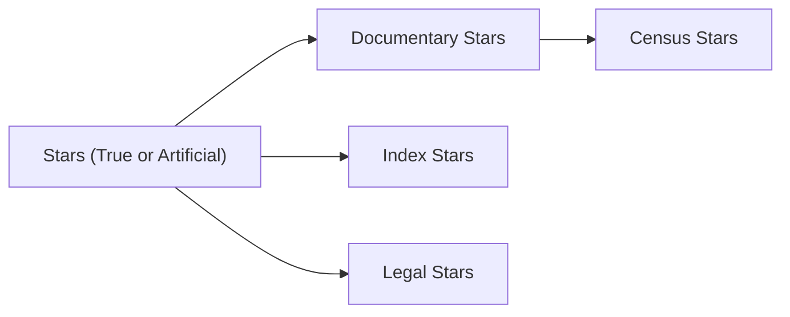

> [!note|callout-wip] [[Meta/Meta|Meta]] || This Article's a Work in Progress!
> This article is currently actively in the process of being written, information it provides may not be canonical, accurate, or otherwise coherent. Think it's in urgent need of completion? File a [GitHub issue](https://github.com/RagtimeGal/encyclopedia-mysenvaria/issues/new/choose).

Star families are a way of grouping and organizing [[Encyclopedia Mysenvaria/Science/Phenomena/Stars|stars]] into taxonomical families based on various aspects of their creation and contents. Star families are a tool used by [[Encyclopedia Mysenvaria/Science/Branches/Astronomy|astronomers]] to better understand the [[Encyclopedia Mysenvaria/Science/Phenomena/Day & Night|night sky]] and the dynamics of the [[Encyclopedia Mysenvaria/History/God-War Era/God-War Era|God-War]].

